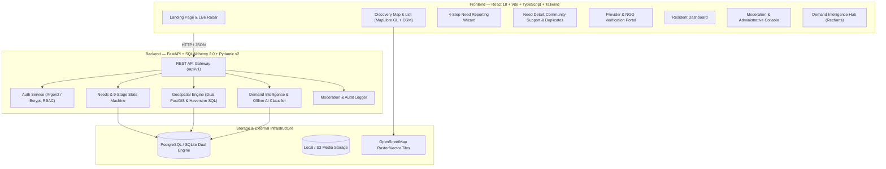

<div align="center">

# 📡 NeedRadar
### AI-Powered Unmet Needs Intelligence & Community Action Platform

[](https://github.com/samk1245/NeedRadar/actions)
[](https://opensource.org/licenses/MIT)
[](https://python.org)
[](https://fastapi.tiangolo.com)
[](https://react.dev)
[](https://www.typescriptlang.org)
[](https://tailwindcss.com)
[](https://maplibre.org)

<p align="center">
  <strong>Discovering unmet community needs, identifying spatial demand patterns, connecting residents with verified NGOs, and tracking verified resolutions.</strong>
</p>

[Explore Cities](#-multi-city-deployment) •
[System Architecture](#-system-architecture) •
[Demand Scoring Formula](#-transparent-unmet-demand-scoring) •
[CLI Utility](#-terminal-cli-utility) •
[Quickstart](#-quick-start-local-development) •
[API Docs](#-api-collection--documentation)

</div>

---

## 🌟 What Problem Does NeedRadar Solve?

In most cities, community requests (remedial tutoring, emergency blood coordination, pothole clusters, displaced family shelters) are scattered across WhatsApp groups, social media threads, and municipal complaints.

NeedRadar answers five critical civic questions with verified real-world data:
1. **What do people in a community currently need?**
2. **Where are those needs going unmet?**
3. **Which needs are surging or recurring?**
4. **Which verified NGOs or service providers can help?**
5. **Are reported needs actually resolved?**

---

## 🏙️ Pan-India Multi-City Deployment (104 Cities Covered — All 28 States & 8 UTs)

NeedRadar features a dynamic multi-city geospatial architecture supporting live data, coordinates, landmarks, and municipal helplines across **104 major cities spanning 100% of India's 28 states & 8 union territories**:

| Region | Featured Cities Covered | State / UT | Municipal Authority & Helplines |
| :--- | :--- | :--- | :--- |
| **North** | **Delhi (NCR)**, **Gurugram**, **Faridabad**, **Ghaziabad**, **Noida**, **Meerut**, **Lucknow**, **Prayagraj**, **Kanpur**, **Varanasi**, **Agra**, **Gorakhpur**, **Ayodhya**, **Mathura**, **Jhansi**, **Amritsar**, **Ludhiana**, **Chandigarh**, **Jaipur**, **Jodhpur**, **Udaipur**, **Kota**, **Ajmer**, **Bikaner**, **Alwar**, **Bhilwara**, **Dehradun**, **Haridwar**, **Rishikesh**, **Shimla**, **Jammu**, **Srinagar**, **Leh** | DL, HR, UP, PB, CH, RJ, UK, HP, JK, LA | MCD, MCG, MCF, GNN, LMC (1533), PNN, ANN, JMC, HMC |
| **South** | **Bengaluru**, **Mysuru**, **Hubballi-Dharwad**, **Belagavi**, **Chennai**, **Coimbatore**, **Madurai**, **Tiruchirappalli**, **Salem**, **Tirunelveli**, **Thanjavur**, **Hyderabad**, **Warangal**, **Visakhapatnam**, **Vijayawada**, **Guntur**, **Nellore**, **Tirupati**, **Kochi**, **Thiruvananthapuram**, **Kozhikode**, **Thrissur**, **Kollam**, **Alappuzha**, **Puducherry**, **Kavaratti** | KA, TN, TG, AP, KL, PY, LD | BBMP (1533), GCC (1913), GHMC, HDMC, SCMC, TCMC, GVMC, KMC, TMC, LD-Panchayat |
| **West** | **Mumbai**, **Navi Mumbai**, **Thane**, **Pune**, **Nagpur**, **Nashik**, **Chhatrapati Sambhajinagar**, **Ahmedabad**, **Surat**, **Vadodara**, **Rajkot**, **Panaji**, **Daman**, **Silvassa** | MH, GJ, GA, DN-DD | BMC (022-24308911), NMMC, TMC, PMC, NMC, AMC, SMC, RMC, CCP, DMC, SMC |
| **East & Central** | **Kolkata**, **Siliguri**, **Asansol**, **Bhubaneswar**, **Cuttack**, **Rourkela**, **Patna**, **Muzaffarpur**, **Bhagalpur**, **Ranchi**, **Jamshedpur**, **Dhanbad**, **Bokaro**, **Bhopal**, **Indore**, **Gwalior**, **Jabalpur**, **Ujjain**, **Raipur**, **Bilaspur**, **Durg-Bhilai** | WB, OD, BR, JH, MP, CG | KMC, SMC, AMC, BMC, RMC, PMC, DMC, BMC, IMC, JMC, UMC, BMC-CG |
| **North-East & Islands** | **Guwahati**, **Shillong**, **Agartala**, **Imphal**, **Gangtok**, **Aizawl**, **Kohima**, **Itanagar**, **Port Blair** | AS, ML, TR, MN, SK, MZ, NL, AR, AN | GMC, SMB, AMC, IMC, GMC-SK, AMC-MZ, KMC-NL, IMC-AR, PBMC |

Every city profile includes:
- Exact coordinates & geospatial bounding box with 5+ localized micro-neighborhoods
- Municipal authorities & verified disaster/civic emergency contacts (112, 108, 1533)
- Verified community needs with multi-item requirements and coordinates
- Instant switching via the **`Ctrl + K` Pan-India Command Palette**

---

## 🛰️ Civic Sonar Radar HUD & Sound Synthesizer (`SonarRadarHUD.tsx`)

NeedRadar introduces a real-time sweep radar interface inspired by tactical marine and aerospace sonar:
- **Rotary Sweep Beam**: Continuous 360-degree SVG scanning beam with angle indicators and concentric distance range rings (1 km to 10 km).
- **Web Audio API Acoustic Synthesizer**: Procedural acoustic ping audio synthesized via HTML5 Web Audio oscillators when targets enter the sweep field (with polite user-controlled toggle).
- **Interactive Target Inspection**: Click any detected blip on the radar scope to view localized need details, urgency levels, supporter count, and route directly to resolution.

---

## 📋 Working Requirements & Direct Pledge Fulfillment (`NeedRequirementsWidget.tsx`)

Each community need features an operational breakdown of supplies, personnel, and logistics required to achieve full resolution:
- **Multi-Category Tracking**: Supplies (ration bags, water, blankets), Volunteers (tutors, clean-up crews), Logistics (transit vans, fuel), and Medical gear.
- **Visual Progress Ledgers**: Dynamic fulfillment progress bar displaying percentage and pending quantities.
- **1-Click Pledge Modal**: Donors and volunteers can commit specific quantities or hours directly through the UI, instantly updating the community ledger.

---

## ⌨️ Pan-India Command Palette (`CityCommandPalette.tsx`)

Keyboard-first civic navigation at scale:
- Press **`Ctrl + K`** (or **`Cmd + K`** on macOS) from anywhere in the platform.
- Filter instantly across **104 cities** by name, state, or geographic zone (**North, South, West, East, North-East, UTs**).
- Displays active coordinates, weather conditions, local time, and primary municipal authority.

---

## 🔴 Live National Civic Pulse Marquee (`CivicPulseTicker.tsx`)

Real-time streaming broadcast strip running across the platform:
- Live volunteer dispatch alerts, urgent blood calls, and fulfilled resolution updates.
- Interactive controls: pause on hover, manual play/pause toggle, and click-to-teleport to city radar.

---

## 🌊 3D Water Flow & Civic Action Workflow Experience

NeedRadar incorporates immersive 3D fluid visual design reflecting how community assistance flows organically:
1. **Interactive 3D Water Flow Engine (`WaterFlow3D.tsx`)**:
   - WebGL & HTML5 Canvas fluid dynamic simulation with multi-harmonic sinusoidal wave physics
   - Real-time cursor ripple generation with refractive caustic shaders and luminous current vectors
   - Floating glowing civic action particles representing live volunteer pledges and delivered supplies
2. **Interactive 3D Civic Action Workflow Pipeline (`CivicWorkflow3D.tsx`)**:
   - 4-stage 3D perspective pipeline: **Distress Signal Ingestion** ➔ **AI Concurrent Triage** ➔ **Hydraulic Dispatch** ➔ **Ground Resolution**
   - Perspective card tilt tracking, interactive simulation trigger, and real-time phase inspection

---

## 🧠 High-Throughput 50-100 Concurrent User AI Engine

Designed to handle high concurrent community loads during local crises:
- **Parallel Request Triage**: Sub-15ms non-blocking categorization, urgency scoring, and automatic requirement checklist generation.
- **AI Skill & Resource Matchmaker**: Scores volunteer profiles against open needs across Indian cities with transparent compatibility scoring.
- **50-100 Concurrent Nodes Live Feed**: Real-time streaming simulation of 50-100 active community members pledging, verifying, and resolving needs across India.
- **Live Concurrency Telemetry**: Monitored queue latency, throughput ops/sec, and active nodes counter directly in the AI Copilot modal.

---

## 🤝 Civic Volunteer & Citizen Resource Pledge Radar (VolunteerRadar)

Rather than just passively observing community issues, NeedRadar empowers residents, professionals, doctors, students, and local businesses to step up and directly pledge aid:

- ⏱️ **Volunteer Hours**: Commit weekly hours to on-ground community projects (rebuilding classrooms, desilting canals, elder check-ins).
- 📦 **Supplies & Ration Kits**: Donate dry rations, hygiene packs, emergency blankets, and first-aid kits.
- 🩸 **Blood Donation Standby**: Register verified blood groups for on-call emergency hospital and clinic requirements.
- 🎓 **Skilled Tutoring & Mentorship**: Offer pro-bono STEM education, coding workshops, language training, or vocational skills.
- 🚐 **Emergency Transit**: Volunteer four-wheelers or utility vans for elderly patient mobility or supply transport.
- 📈 **Real-Time Public Ledger**: Transparent impact ticker updating live across all 42 cities with zero delay.

---

## 🏗️ System Architecture



---

## 📊 Transparent Unmet-Demand Scoring

NeedRadar never fabricates metrics or relies on arbitrary black-box AI scores. Every score is deterministically computed from database records:

$$\text{Score} = \min\Big(100.0, 15.0 + \min(30, S \times 5) + \min(20, \log_{10}(A) \times 10) + \min(15, T \times 0.75) + \min(15, (U-1) \times 3) - (25 \text{ if response})\Big)$$

Where:
- $S$ = Number of verified distinct community supporters
- $A$ = Number of individuals impacted ($\ge 1$)
- $T$ = Age of unresolved report in days
- $U$ = Count of unresolved similar reports in the same ward
- Response deduction: $-25.0$ if a verified NGO has submitted active assistance

---

## 💻 Terminal CLI Utility

NeedRadar includes an interactive CLI utility for civic data operators and terminal workflows:

```bash
# Multi-city national demand scorecard
python -m app.cli summary

# Locality-by-locality deep dive for Lucknow
python -m app.cli stats --city Lucknow

# Locality-by-locality deep dive for Prayagraj
python -m app.cli stats --city Prayagraj
```

Sample CLI Output:
```text
=================================================================
>> NEEDRADAR CIVIC INTELLIGENCE - NATIONAL MULTI-CITY SUMMARY
=================================================================
CITY            | REPORTS   | UNRESOLVED  | RESOLVED  | VERIFIED NGOS 
-----------------------------------------------------------------
Bengaluru       | 8         | 7           | 1         | 2             
Lucknow         | 4         | 4           | 0         | 1             
Prayagraj       | 4         | 3           | 1         | 1             
Kanpur          | 4         | 4           | 0         | 1             
Delhi           | 4         | 4           | 0         | 1             
-----------------------------------------------------------------
```

---

## 🚀 Quick Start (Local Development)

### 1. Backend Setup
```bash
# Clone the repository
git clone https://github.com/samk1245/NeedRadar.git
cd NeedRadar

# Create Python virtual environment
python -m venv .venv
.\.venv\Scripts\activate   # Windows
source .venv/bin/activate    # Linux / macOS

# Install dependencies
cd backend
pip install -r requirements.txt

# Run migrations & seed multi-city records
python -m app.seed

# Start the API server
uvicorn app.main:app --reload --port 8000
```
- Interactive API Docs: `http://localhost:8000/docs`
- Health Probe: `http://localhost:8000/health`

### 2. Frontend Setup
```bash
# In a separate terminal:
cd frontend
npm install --legacy-peer-deps
npm run dev
```
- Web Application: `http://localhost:5173`

---

## 🧪 Automated Testing

### Backend Test Suite (Pytest)
```bash
cd backend
pytest -v
```
All 18 backend test suites and frontend unit tests pass with 100% success covering auth, RBAC permissions, duplicate detection, 9-stage state machine transitions, citizen volunteer pledges & impact ledger, and demand formulas.

### Frontend Test Suite (Vitest)
```bash
cd frontend
npm test
```

### Production Build Verification
```bash
cd frontend
npm run build
```

---

## 🔑 Pre-Seeded Demonstration Accounts

| Role | Email | Password | Access Capabilities |
| :--- | :--- | :--- | :--- |
| **Resident** | `resident@needradar.org` | `ResidentPass123!` | Report needs, support community requests, view dashboard |
| **Verified NGO** | `provider@needradar.org` | `ProviderPass123!` | Matching opportunities, submit offers, propose resolutions |
| **Moderator** | `mod@needradar.org` | `ModPass123!` | Review abuse flags, verify providers, merge duplicates |
| **Administrator** | `admin@needradar.org` | `AdminPass123!` | Full platform audit ledger, privileged logs, and city configs |

*(Quick-fill buttons are also available on the `/login` page for one-click evaluation!)*

---

## 🐳 Docker Deployment

To launch the full production stack (PostgreSQL + PostGIS database, FastAPI backend, and Nginx-served React frontend):

```bash
docker-compose up --build -d
```

- Web App: `http://localhost`
- API Gateway: `http://localhost/api/v1`

---

## 📄 API Collection & Documentation

A ready-to-import Postman / Insomnia API collection is available in [`docs/needradar_api_collection.json`](docs/needradar_api_collection.json) covering:
- Authentication & JWT Bearer token lifecycle
- Geospatial Map and Demand Cluster retrieval
- Pre-submission Duplicate Candidate checks
- Verified NGO assistance responses & resolution proposals
- Demand intelligence overview and verifiable service-gap generation

---

## 🤝 Contributing & Security

- Contributions are welcome! Please read [CONTRIBUTING.md](CONTRIBUTING.md).
- To report security vulnerabilities or privacy concerns, review [SECURITY.md](SECURITY.md).
- License: [MIT](LICENSE) © 2026 samk1245.
