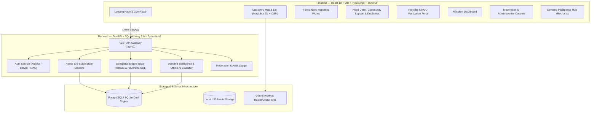

<div align="center">

# 📡 NeedRadar
### AI-Powered Unmet Needs Intelligence & Community Action Platform

[](https://github.com/samk1245/NeedRadar/actions)
[](https://opensource.org/licenses/MIT)
[](https://python.org)
[](https://fastapi.tiangolo.com)
[](https://react.dev)
[](https://www.typescriptlang.org)
[](https://tailwindcss.com)
[](https://maplibre.org)

<p align="center">
  <strong>Discovering unmet community needs, identifying spatial demand patterns, connecting residents with verified NGOs, and tracking verified resolutions.</strong>
</p>

[Explore Cities](#-multi-city-deployment) •
[System Architecture](#-system-architecture) •
[Demand Scoring Formula](#-transparent-unmet-demand-scoring) •
[CLI Utility](#-terminal-cli-utility) •
[Quickstart](#-quick-start-local-development) •
[API Docs](#-api-collection--documentation)

</div>

---

## 🌟 What Problem Does NeedRadar Solve?

In most cities, community requests (remedial tutoring, emergency blood coordination, pothole clusters, displaced family shelters) are scattered across WhatsApp groups, social media threads, and municipal complaints.

NeedRadar answers five critical civic questions with verified real-world data:
1. **What do people in a community currently need?**
2. **Where are those needs going unmet?**
3. **Which needs are surging or recurring?**
4. **Which verified NGOs or service providers can help?**
5. **Are reported needs actually resolved?**

---

## 🏙️ Multi-City Deployment

NeedRadar features a dynamic multi-city architecture supporting live data and coordinates across India's largest metropolitan regions:

| City | State | Coordinates | Seeded Localities | Verified Partner NGOs |
| :--- | :--- | :--- | :--- | :--- |
| **Lucknow** | Uttar Pradesh | `26.8467° N, 80.9462° E` | Hazratganj, Gomti Nagar, Aliganj, Chowk, Charbagh | *Awadh Seva Sansthan* |
| **Prayagraj** | Uttar Pradesh | `25.4358° N, 81.8463° E` | Civil Lines, Katra, Georgetown, Daraganj, Naini | *Sangam Relief & Educational Trust* |
| **Kanpur** | Uttar Pradesh | `26.4499° N, 80.3319° E` | Civil Lines, Swaroop Nagar, Kakadeo, Mall Road | *Ganga Seva Community Mission* |
| **Delhi (NCR)** | NCT of Delhi | `28.6139° N, 77.2090° E` | Connaught Place, Lajpat Nagar, Rohini, Saket, Chandni Chowk | *Delhi Nagrik Sahayata Samiti* |
| **Bengaluru** | Karnataka | `12.9716° N, 77.5946° E` | Koramangala, Indiranagar, HSR Layout, Whitefield, Jayanagar | *Vidya Samarth Trust*, *Arogya Mitra* |
| **Mumbai** | Maharashtra | `19.0760° N, 72.8777° E` | Bandra, Andheri, Colaba, Dadar, Powai, Borivali | Configured in multi-city registry |
| **Hyderabad** | Telangana | `17.3850° N, 78.4867° E` | Banjara Hills, Hitec City, Jubilee Hills, Gachibowli | Configured in multi-city registry |

---

## 🏗️ System Architecture



---

## 📊 Transparent Unmet-Demand Scoring

NeedRadar never fabricates metrics or relies on arbitrary black-box AI scores. Every score is deterministically computed from database records:

$$\text{Score} = \min\Big(100.0, 15.0 + \min(30, S \times 5) + \min(20, \log_{10}(A) \times 10) + \min(15, T \times 0.75) + \min(15, (U-1) \times 3) - (25 \text{ if response})\Big)$$

Where:
- $S$ = Number of verified distinct community supporters
- $A$ = Number of individuals impacted ($\ge 1$)
- $T$ = Age of unresolved report in days
- $U$ = Count of unresolved similar reports in the same ward
- Response deduction: $-25.0$ if a verified NGO has submitted active assistance

---

## 💻 Terminal CLI Utility

NeedRadar includes an interactive CLI utility for civic data operators and terminal workflows:

```bash
# Multi-city national demand scorecard
python -m app.cli summary

# Locality-by-locality deep dive for Lucknow
python -m app.cli stats --city Lucknow

# Locality-by-locality deep dive for Prayagraj
python -m app.cli stats --city Prayagraj
```

Sample CLI Output:
```text
=================================================================
>> NEEDRADAR CIVIC INTELLIGENCE - NATIONAL MULTI-CITY SUMMARY
=================================================================
CITY            | REPORTS   | UNRESOLVED  | RESOLVED  | VERIFIED NGOS 
-----------------------------------------------------------------
Bengaluru       | 8         | 7           | 1         | 2             
Lucknow         | 4         | 4           | 0         | 1             
Prayagraj       | 4         | 3           | 1         | 1             
Kanpur          | 4         | 4           | 0         | 1             
Delhi           | 4         | 4           | 0         | 1             
-----------------------------------------------------------------
```

---

## 🚀 Quick Start (Local Development)

### 1. Backend Setup
```bash
# Clone the repository
git clone https://github.com/samk1245/NeedRadar.git
cd NeedRadar

# Create Python virtual environment
python -m venv .venv
.\.venv\Scripts\activate   # Windows
source .venv/bin/activate    # Linux / macOS

# Install dependencies
cd backend
pip install -r requirements.txt

# Run migrations & seed multi-city records
python -m app.seed

# Start the API server
uvicorn app.main:app --reload --port 8000
```
- Interactive API Docs: `http://localhost:8000/docs`
- Health Probe: `http://localhost:8000/health`

### 2. Frontend Setup
```bash
# In a separate terminal:
cd frontend
npm install --legacy-peer-deps
npm run dev
```
- Web Application: `http://localhost:5173`

---

## 🧪 Automated Testing

### Backend Test Suite (Pytest)
```bash
cd backend
pytest -v
```
All 12 test suites pass with 100% success covering auth, RBAC permissions, duplicate detection, 9-stage state machine transitions, and demand formulas.

### Frontend Test Suite (Vitest)
```bash
cd frontend
npm test
```

### Production Build Verification
```bash
cd frontend
npm run build
```

---

## 🔑 Pre-Seeded Demonstration Accounts

| Role | Email | Password | Access Capabilities |
| :--- | :--- | :--- | :--- |
| **Resident** | `resident@needradar.org` | `ResidentPass123!` | Report needs, support community requests, view dashboard |
| **Verified NGO** | `provider@needradar.org` | `ProviderPass123!` | Matching opportunities, submit offers, propose resolutions |
| **Moderator** | `mod@needradar.org` | `ModPass123!` | Review abuse flags, verify providers, merge duplicates |
| **Administrator** | `admin@needradar.org` | `AdminPass123!` | Full platform audit ledger, privileged logs, and city configs |

*(Quick-fill buttons are also available on the `/login` page for one-click evaluation!)*

---

## 🐳 Docker Deployment

To launch the full production stack (PostgreSQL + PostGIS database, FastAPI backend, and Nginx-served React frontend):

```bash
docker-compose up --build -d
```

- Web App: `http://localhost`
- API Gateway: `http://localhost/api/v1`

---

## 📄 API Collection & Documentation

A ready-to-import Postman / Insomnia API collection is available in [`docs/needradar_api_collection.json`](docs/needradar_api_collection.json) covering:
- Authentication & JWT Bearer token lifecycle
- Geospatial Map and Demand Cluster retrieval
- Pre-submission Duplicate Candidate checks
- Verified NGO assistance responses & resolution proposals
- Demand intelligence overview and verifiable service-gap generation

---

## 🤝 Contributing & Security

- Contributions are welcome! Please read [CONTRIBUTING.md](CONTRIBUTING.md).
- To report security vulnerabilities or privacy concerns, review [SECURITY.md](SECURITY.md).
- License: [MIT](LICENSE) © 2026 samk1245.
